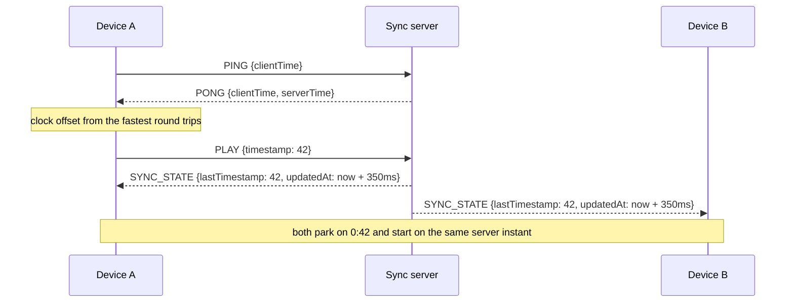

# Sub50

Paste a YouTube link, and everyone in the room hears it on their own device and headphones, in lockstep, with under 50ms of drift.

No audio goes through the server. Every device runs its own YouTube IFrame player; the server only keeps one authoritative timeline and each client steers its player onto it.

## Quick start

Requires Node 22.12+ (Node 24 recommended).

```bash
npm install
npm run dev
```

`npm run dev` starts the sync server (`:3001`) and the Vite client (`:5173`), then prints the URL for phones plus a QR code:

```text
◉ Sub50 is live
Desktop:  http://localhost:5173
Phone:    http://192.168.1.23:5173  (Wi-Fi)
```

1. Open `http://localhost:5173` on your computer. You get a fresh room (`?room=abc-xyz`).
2. Click **Copy LAN Link** (or the QR button) in the header and open it on your phone. On `localhost` the link is rewritten to your LAN IP automatically.
3. Tap **Tap to Enter Sub50** on each device. This unlocks audio; mobile browsers refuse unmuted playback that doesn't start inside a tap.
4. Paste a link and hit **Play Now** or **+ Queue**.

> **Phone can't connect?** It must be on the same Wi-Fi, and on Windows the first run needs Node.js allowed through the firewall for **Private** networks. Guest or "client isolation" Wi-Fi blocks device-to-device traffic entirely.

The **Listeners** panel shows every device's drift and round-trip time, which is the quickest way to watch the room lock.

## How sync works



**Clock sync (NTP-lite).** Each round trip gives `rtt = now - clientTime` and `offset = serverTime - (clientTime + rtt/2)`. That estimate assumes the trip was symmetric, so a slow sample (busy main thread, Wi-Fi power-save wakeup) can be off by half its RTT. Sub50 keeps the last 16 samples and averages the offsets of the 3 fastest. It pings in a burst on connect, then every 2s, and again whenever the tab wakes up.

**Room timeline.** Every client computes where the room is right now:

```text
serverNow    = Date.now() + clockOffset
expectedTime = lastTimestamp + (serverNow - updatedAt) / 1000
```

PLAY, SEEK and track changes are **scheduled** slightly in the future (`updatedAt = now + 350ms`, or `+1.5s` for a new track). Devices buffer (a new track preloads muted), wait on the start line, and call `playVideo()` just early enough to hit the instant, with each device learning its own start latency. Without scheduling, every device would start whenever its packet happened to arrive.

**Drift correction.** Each device samples `player.getCurrentTime() - expectedTime` every 250ms and decides once per second from a 3-sample median:

| drift | action |
|---|---|
| < 50ms | **SUB50 LOCKED**, nothing to do |
| 50–150ms | tolerated, no correction (avoids audible artefacts) |
| 150ms–1.5s | playback rate 1.05× / 0.95× until back within ~20ms |
| > 1.5s | hard `seekTo(expected + learned seek latency)` |

Right after a load, seek or resume there is no audio continuity to protect, so the bands tighten (nudge from 50ms, seek from 250ms) to lock quickly. If a video ignores fractional rates, the engine detects it and seeks instead.

**No echo loops.** Programmatic player commands run with `isRemoteUpdateRef` raised, so the `onStateChange` they trigger is never sent back to the server. A pause that comes from you (tapping the video, lock-screen or headphone controls) is shared with the room, but only out of steady playback while the page is visible. A phone locking its screen, or a browser blocking autoplay, never pauses everyone.

**Accepted links:** `youtube.com/watch?v=`, `youtu.be/`, `youtube.com/shorts/`, `music.youtube.com/watch?v=`, `/embed/`, `/live/`, `youtube-nocookie.com`, or a bare 11-character id.

## Scripts

| command | does |
|---|---|
| `npm run dev` | server + client with hot reload, prints LAN URL + QR |
| `npm test` | unit tests (URL parser, room engine, clock sync, drift bands) |
| `npm run typecheck` | `tsc --noEmit` for server and client |
| `npm run build` | client → `client/dist`, server → `server/dist/index.js` |
| `npm start` | production server: serves `client/dist` and `/ws` on one port |

## Deploying

Production is one Node process: it serves the built client and the WebSocket on `$PORT`, with a health check at `/healthz`.

```bash
npm run build && PORT=8080 npm start     # or:
docker build -t sub50 . && docker run -p 3001:3001 sub50
```

Room state lives **in memory**, so run exactly **one instance**. Two replicas would split rooms between them, and a restart clears all rooms (clients reconnect and re-join automatically, but queues are lost).

- **Railway**: deploy the repo; it detects the Dockerfile, or set build `npm run build` and start `npm start`. `PORT` is injected.
- **Render**: Web Service, build `npm ci && npm run build`, start `npm start`, health check path `/healthz`. WebSockets work on web services.
- **Fly.io**: `fly launch` (uses the Dockerfile; internal port `3001`), then `fly scale count 1`. In `fly.toml` set `auto_stop_machines = "off"` and `min_machines_running = 1` so idle rooms survive.

Behind HTTPS the client switches to `wss://` automatically. To host the client separately from the server, build it with `VITE_WS_URL=wss://your-server/ws`.

| env | default | used by |
|---|---|---|
| `PORT` | `3001` | server |
| `HOST` | `0.0.0.0` | server bind address |
| `CLIENT_DIST` | `client/dist` | server static files |
| `VITE_WS_URL` | same origin `/ws` | client build |
| `SUB50_SERVER` | `http://127.0.0.1:3001` | Vite dev proxy target |
| `CLIENT_PORT` | `5173` | LAN banner |

## Known limits

- **Bluetooth output latency is invisible to the browser.** Two players can be locked within 10ms while one listener's earbuds add 150–250ms on top. Wired headphones (or the same model on every device) keep the audible result inside Sub50's numbers.
- **Background playback**: iOS and some Android browsers pause the YouTube embed when the screen locks. Sub50 resyncs as soon as the page is visible again; tap **Resync** if needed.
- **Embedding**: some uploads (often official music videos) disallow embedding and show an error in the deck. Try another upload.
- **Access**: no accounts. Anyone with the room link can control playback, by design for a shared jam on your own network.

## Layout

```text
shared/   protocol types, sync tunables, YouTube URL parser
server/   Express + ws: RoomManager, validation, PING/PONG, static hosting
client/   React + Tailwind: useYouTubeSync drift engine, clock sync, UI
scripts/  LAN banner for `npm run dev`
```
