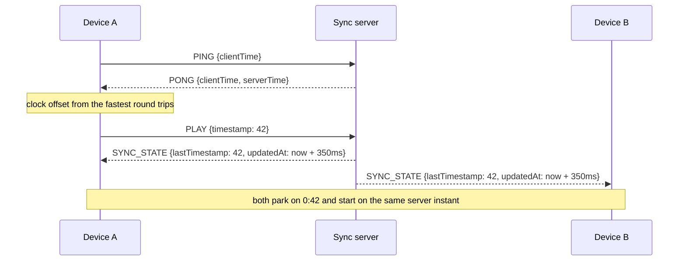
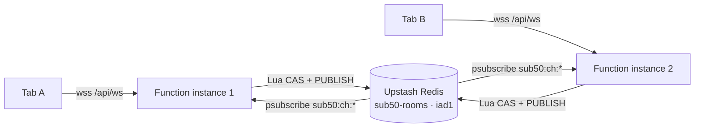

# Sub50

Paste a YouTube link, and everyone in the room hears it on their own device and headphones, in lockstep, with under 50ms of drift.

No audio goes through the server. Every device runs its own YouTube IFrame player; the server only keeps one authoritative timeline and each client steers its player onto it.

**Live:** https://sub50.vercel.app — open it, share the room link, listen together.

**Stack:** Next.js 16 (App Router) · TypeScript · Tailwind CSS 4 · `ws` · Upstash Redis. The sync channel is `/api/ws`: on Vercel a Function serves it with rooms in Redis; locally (or self-hosted) `server.ts` serves Next.js and `/api/ws` in **one process on one port** with rooms in memory.

## Quick start

Requires Node 22.12+ (Node 24 recommended).

```bash
npm install
npm run dev
```

`npm run dev` starts Next.js with hot reload and the `/api/ws` sync socket on port 3000 (rooms in memory, no Redis needed), then prints the URL for phones plus a QR code:

```text
◉ Sub50 dev server on 0.0.0.0:3000  (sync socket: /api/ws)
Desktop:  http://localhost:3000
Phone:    http://192.168.1.23:3000
```

1. Open `http://localhost:3000` on your computer. The server redirects you to a fresh room (`/?room=abc-xyz`).
2. Click **Copy LAN Link** (or the QR button) in the header and open it on your phone. On `localhost` the link is rewritten to your LAN IP automatically.
3. Tap **Tap to Enter Sub50** on each device. This unlocks audio; mobile browsers refuse unmuted playback that doesn't start inside a tap.
4. Paste a link and hit **Play Now** or **+ Queue**.

> **Phone can't connect?** It must be on the same Wi-Fi, and on Windows the first run needs Node.js allowed through the firewall for **Private** networks. Guest or "client isolation" Wi-Fi blocks device-to-device traffic entirely.

The **Listeners** panel shows every device's drift and round-trip time, which is the quickest way to watch the room lock.

## How sync works



**Clock sync (NTP-lite).** Each round trip gives `rtt = now - clientTime` and `offset = serverTime - (clientTime + rtt/2)`. That estimate assumes the trip was symmetric, so a slow sample (busy main thread, Wi-Fi power-save wakeup) can be off by half its RTT. Sub50 keeps the last 16 samples and averages the offsets of the 3 fastest. It pings in a burst on connect, then every 2s, and again whenever the tab wakes up.

**Room timeline.** Every client computes where the room is right now:

```text
serverNow    = Date.now() + clockOffset
expectedTime = lastTimestamp + (serverNow - updatedAt) / 1000
```

PLAY, SEEK and track changes are **scheduled** slightly in the future (`updatedAt = now + 350ms`, or `+1.5s` for a new track). Devices buffer (a new track preloads muted), wait on the start line, and call `playVideo()` just early enough to hit the instant, with each device learning its own start latency. Without scheduling, every device would start whenever its packet happened to arrive.

**Drift correction.** Each device samples `player.getCurrentTime() - expectedTime` every 250ms and decides once per second from a 3-sample median:

| drift | action |
|---|---|
| < 50ms | **SUB50 LOCKED**, nothing to do |
| 50–150ms | tolerated, no correction (avoids audible artefacts) |
| 150–300ms | playback rate 1.05× / 0.95× until back within ~20ms |
| 300–600ms | playback rate 1.10× / 0.90×, so a nudge never drags on |
| > 600ms | hard `seekTo(expected + learned seek latency)` |

Right after a load, seek or resume there is no audio continuity to protect, so the bands tighten (nudge from 50ms, seek from 250ms) to lock quickly. A nudge has to prove itself: if drift hasn't moved at least 40% of what the rate implies after 2s (some mobile YouTube players accept a fractional rate without playing faster), the engine switches that device to seeking. Phones also start with a larger seek lead, get a 2.5s preroll on track changes, and default to audio-only, which pulls YouTube's smallest stream and stalls less.

**No echo loops.** Programmatic player commands run with `isRemoteUpdateRef` raised, so the `onStateChange` they trigger is never sent back to the server. A pause that comes from you (tapping the video, lock-screen or headphone controls) is shared with the room, but only out of steady playback while the page is visible. A phone locking its screen, or a browser blocking autoplay, never pauses everyone.

**Accepted links:** `youtube.com/watch?v=`, `youtu.be/`, `youtube.com/shorts/`, `music.youtube.com/watch?v=`, `/embed/`, `/live/`, `youtube-nocookie.com`, or a bare 11-character id.

## Scripts

| command | does |
|---|---|
| `npm run dev` | `tsx watch server.ts --dev`: Next.js + HMR + `/api/ws` on :3000, prints LAN URL + QR |
| `npm test` | unit tests (URL parser, room engine, clock sync, drift bands) |
| `npm run typecheck` | `tsc --noEmit` over the whole project |
| `npm run build` | `next build` (type-checks too); this is what Vercel runs |
| `npm run build:server` | bundles `server.ts` → `dist/server.js` for self-hosting |
| `npm start` | self-hosted production: `node dist/server.js` serves Next.js and `/api/ws` on `$PORT` |

Redis integration tests run only with credentials: `npx tsx --env-file=.env.local --test src/server/store/redis.test.ts`.

In dev, phones load the site by LAN IP, so `next.config.ts` adds this machine's LAN addresses to `allowedDevOrigins`. Without that, Next blocks the HMR and dev chunks for those origins.

## Deploying

### Vercel (what https://sub50.vercel.app runs)



- `src/app/api/ws/route.ts` upgrades the request with `upgradeWebSocket()` from `@vercel/functions`. Sockets of one room can land on different instances, so rooms, presence and broadcasts live in **Upstash Redis**. Every commit is a compare-and-swap on the room's `(epoch, seq)` that publishes the new state in the same atomic step.
- **Sockets rotate every 5 minutes on Hobby** (`maxDuration = 300`). The client reconnects in ~50ms with the same per-tab session id, so it stays the same listener (and host). Playback doesn't stop: it runs on the local clock between sockets.
- Functions and Redis are pinned to the same region (`vercel.ts` → `iad1`), so room operations are in-region round trips. **Clock-sync accuracy depends on the listener ↔ region path**: pick the region closest to where people actually listen. Upstash fixes a database's primary region at creation, so moving region means a new database (`vercel integration add upstash/upstash-kv --meta primaryRegion=<region>`) plus `regions` in `vercel.ts`.

Setup from scratch:

```bash
vercel link                                    # creates/links the project (and can connect the Git repo)
vercel integration add upstash/upstash-kv --meta primaryRegion=iad1   # accept Upstash terms in the browser once
vercel env pull .env.local                     # KV_REST_API_URL / KV_REST_API_TOKEN for local Redis tests
git push                                       # with the Git integration: PRs get previews, main deploys to production
```

Preview deployments sit behind Vercel's deployment protection and share the same Redis database as production (room ids are random, so they don't collide). To test a preview's `/api/ws` from a script, send the local `VERCEL_OIDC_TOKEN` from `.env.local` as the `x-vercel-trusted-oidc-idp-token` header.

**Redis budget:** clock sync (PING/PONG) never touches Redis; it is answered by the instance holding the socket. Room commands are 2 Redis commands each, presence is refreshed once a minute per listener, and telemetry is throttled (steady-state jitter at most every 10s). A two-person session is in the low hundreds of commands per hour, which fits the Upstash free tier for regular listening.

### Self-hosting (one process, no Redis)

```bash
npm run build && npm run build:server && PORT=8080 npm start     # or:
docker build -t sub50 . && docker run -p 3000:3000 sub50
```

`server.ts` keeps rooms in memory, so run exactly **one instance** (a restart clears rooms; clients reconnect and re-join automatically). Health check: `/healthz`.

- **Railway**: deploy the repo; it detects the Dockerfile. `PORT` is injected.
- **Render**: Web Service, build `npm ci && npm run build && npm run build:server`, start `npm start`, health check `/healthz`.
- **Fly.io**: `fly launch` (Dockerfile, internal port `3000`), `fly scale count 1`, and in `fly.toml` set `auto_stop_machines = "off"`, `min_machines_running = 1`.

Behind HTTPS the client switches to `wss://` automatically. To point the client at a sync server on another host, build with `NEXT_PUBLIC_WS_URL=wss://your-server/api/ws`.

| env | default | used by |
|---|---|---|
| `KV_REST_API_URL` / `KV_REST_API_TOKEN` | set by the Upstash integration | Vercel Function (Redis rooms) |
| `PORT` | `3000` | self-hosted server |
| `HOST` | `0.0.0.0` | self-hosted bind address |
| `NEXT_PUBLIC_WS_URL` | same origin `/api/ws` | client build (inlined by Next) |

## Known limits

- **Bluetooth output latency is invisible to the browser.** Two players can be locked within 10ms while one listener's earbuds add 150–250ms on top. Wired headphones (or the same model on every device) keep the audible result inside Sub50's numbers.
- **Background playback**: iOS and some Android browsers pause the YouTube embed when the screen locks. Sub50 resyncs as soon as the page is visible again; tap **Resync** if needed.
- **Embedding**: some uploads (often official music videos) disallow embedding and show an error in the deck. Try another upload.
- **Access**: no accounts. Anyone with the room link can control playback, by design for a shared jam on your own network.

## Layout

```text
server.ts            self-hosted server: Next.js handler, /api/ws sync socket, /healthz, LAN banner
next.config.ts       allowedDevOrigins (LAN IPs), Turbopack root
vercel.ts            Vercel project config: function region next to Redis
src/
├── app/             App Router: layout, page (server-side ?room= redirect), globals.css
│   └── api/ws/      the sync socket as a Vercel Function (upgradeWebSocket)
├── components/      ClientShell (ssr: false) → Sub50App, deck, scrubber, queue, gate, telemetry pill
├── hooks/           useYouTubeSync (drift engine), useRoom (socket → React state)
├── lib/             clock sync, reconnecting socket client, drift math, YouTube API loader, session id
├── server/
│   ├── engine.ts    pure room state machine (every transition, no I/O)
│   ├── hub.ts       per-instance SyncHub: local sockets, presence, telemetry throttling
│   ├── socket.ts    attachSocket(): WELCOME, PING/PONG, flood guard, heartbeat, ordered commands
│   ├── store/       RoomStore: memory (self-host) · Upstash Redis (Vercel)
│   └── …            message validation, oEmbed titles, LAN detection
└── shared/          wire protocol + sync tunables, YouTube URL parser, room ids
```

The player is a client component loaded with `ssr: false`, because it needs the YouTube IFrame API, the autoplay unlock and `localStorage`. The page itself is a server component that validates `?room=` and redirects to a fresh room before any JavaScript runs.
